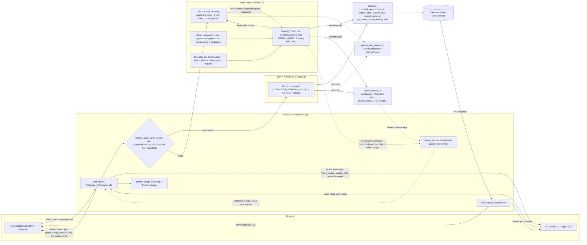

# live-smarthome-agent #

### 1) Prework
Ensure following baseline roles are added to the account on a fresh run\
(setup.sh will verify these and automatically grant the remaining operator roles):
  - Project IAM Admin (roles/resourcemanager.projectIamAdmin)
  - Service Usage Admin (roles/serviceusage.serviceUsageAdmin)

Edit the .env file (changing <project_id>)

### 2) Setup the infra, IAM, etc
```bash
bash setup.sh
```

### 3) Create a virtual environment and install dependencies
```bash
uv venv
source .venv/bin/activate
uv pip install -r requirements.txt
```

### 4a) Start the server (active)
```bash
uv run main.py
```

### 4b) Start the server (in background)
```bash
tmux new-session -d -s smarthome 'uv run main.py'
tmux attach-session -t smarthome
```

### 5) Access via these URLs
http://localhost:8001/live-smarthome-agent               # Main UI (Auto-resolves default or ?ui=v2 / ?ui=v1)
http://localhost:8001/live-smarthome-agent/v1            # Explicit v1 Legacy UI
http://localhost:8001/live-smarthome-agent/v2            # Explicit v2 Supabase Developer UI
http://localhost:8001/live-smarthome-agent/initialize    # Admin / Firestore Initializer
http://localhost:8001/live-smarthome-agent/camview        # Camera Feed Viewer

### 6) Visual Versions & Switching
The application supports multi-version frontend visuals over an identical backend:
- **v1 Legacy UI**: Apple-inspired dark glassmorphism dashboard.
- **v2 Supabase UI**: Developer-first dark emerald theme based on the [Supabase Design System](DESIGN.md).
- **Switching Methods**:
  1. **In-App Toggle**: Click the segmented switcher in the top bar or settings drawer.
  2. **Query Parameter**: Append `?ui=v1` or `?ui=v2` to the URL.
  3. **Environment Default**: Set `SMARTHOME_UI_VERSION=v2` in `.env`.

### 7) Agent Architectures (per WebSocket session)
| Arch | What runs | Who uses it |
|---|---|---|
| `monolithic` | One Gemini Live agent with all rules + 6 device tools (original). | v1 (default) |
| `brain` | Thin Gemini Live voice layer with one tool (`smart_home_request`) delegating to a Flash Lite **brain** (`brain.py`) via `generateContent`. The brain's static prefix (rules, tool declarations, examples) is byte-identical every call so **implicit context caching** can hit; device state and the request go last. The brain returns facts only; Live words them. | v2 (sends `?arch=brain`) |

#### Architecture diagram


- Resolution order: `?arch=` on the WebSocket → `SMARTHOME_AGENT_ARCH` in `.env` → `monolithic`.
- A/B in v2: open `/live-smarthome-agent/v2?arch=monolithic`.
- UI compatibility: every tool the brain runs is mirrored to the WebSocket as an ADK-shaped `functionCall`/`functionResponse` event (never sent to the Live session), so v1 and v2 hero cards, camera modal and tool logs work under either architecture.
- Brain token usage (incl. `cached_content_token_count`) is logged as `subagent_usage ... brain ...` rows in `gemini_usage_trace.log` and shown in v2 under **Telemetry & Vocabulary → BRAIN (SUB-AGENT)**.
